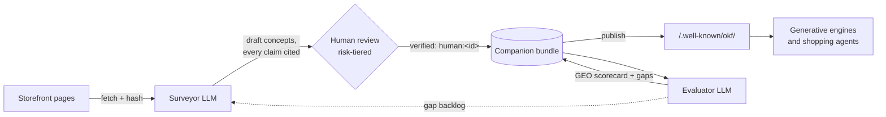

# OKF-Web

**A companion knowledge layer for ecommerce GEO** — survey a
storefront into an [Open Knowledge Format (OKF) v0.2](https://github.com/GoogleCloudPlatform/knowledge-catalog/tree/main/okf)
bundle with an LLM, verify it with a human in the loop, measure its
answerability for generative engines, and publish it alongside the
site at `/.well-known/okf/`.

Shoppers now ask AI assistants the questions they used to type into
search. OKF-Web gives a store a machine-native tier those engines can
actually use: compact, citable, provenance-tracked markdown facts —
plus **attested computations** that teach agents to fetch live prices
and stock from the store's own APIs instead of quoting stale numbers.



The loop in one sentence: **an LLM populates, a linter gates, a human
verifies, a static host serves, and an evaluator measures — then the
gaps feed the next pass.**

## Why OKF

OKF bundles are plain markdown + YAML frontmatter with provenance
built in: `generated` (who wrote it), `verified` (who checked it —
trust tiers key off the `human:` actor prefix), `sources` with
per-claim footnotes, `stale_after` freshness, and `Attested
Computation` for facts that must be executed, not stored. No SDK, no
lock-in; any engine that reads files can consume it.

## Repository map

| Path | What it is |
| --- | --- |
| [`docs/DESIGN.md`](docs/DESIGN.md) | The system design — architecture, novelty, threat model, efficiency budget |
| [`docs/GEO-PROFILE.md`](docs/GEO-PROFILE.md) | The `ecommerce-geo/1.0` profile: concept types, `x_geo` namespace, risk tiers, `http` runtime |
| [`docs/EVALUATION.md`](docs/EVALUATION.md) | The answerability rubric: archetypes, metrics, gating |
| [`bundle-example/`](bundle-example/index.md) | Complete conformant companion bundle for a fictional store |
| [`src/okf_web/`](src/okf_web/) | Reference implementation (`okf-web` CLI) |
| [`src/okf_web/prompts/`](src/okf_web/prompts/) | The versioned LLM prompts: extraction contract, question generation, answerer, judge |
| [`tests/`](tests/) | Test suite; the example bundle is linted in CI |

## Quickstart

```bash
pip install -e .[dev]        # add [llm] for LLM-backed commands (Anthropic)

# Inspect the example bundle
okf-web lint bundle-example --strict
okf-web review list bundle-example
okf-web evaluate bundle-example --dry-run

# The human-in-the-loop moment: approve the draft warranty policy
okf-web review approve bundle-example policies/warranty.md --by legal@alpinepeakoutfitters.example

# Build the static companion (refuses to ship unapproved high-risk drafts)
okf-web publish bundle-example dist/

# Against a real store (needs ANTHROPIC_API_KEY)
okf-web survey my-bundle --sitemap https://www.example-store.com --limit 25
okf-web questions my-bundle
okf-web evaluate my-bundle --write-scorecard
```

`okf-web review list` on the example bundle shows one item: the
warranty policy — a high-risk draft the linter and publisher both
refuse to ship until a human approves it. That invariant (lint rule
E010) is the heart of the design: **no price, policy, or safety claim
reaches an AI engine without a named human verifier**, while low-risk
descriptive facts flow at machine speed.

## Hosting the companion

`okf-web publish` emits a static tree — bundle + `manifest.json`
(sha256 delta sync) + `linkmap.json` (page ⇄ concept `<link>` tags) +
`llms-snippet.txt` (discovery via `llms.txt`). Serve it from the same
CDN as the site at `/.well-known/okf/`; config snippets are in
[docs/DESIGN.md §8](docs/DESIGN.md#8-hosting-and-discovery).

## Status

Reference implementation accompanying the design. The fictional store
in `bundle-example/` uses reserved `.example` domains throughout.
