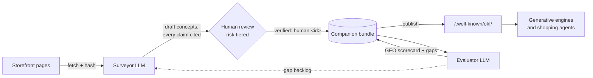

# OKF-Web

**A companion knowledge layer for ecommerce GEO** — survey a
storefront into an [Open Knowledge Format (OKF) v0.2](https://github.com/GoogleCloudPlatform/knowledge-catalog/tree/main/okf)
bundle with an LLM, verify it with a human in the loop, measure its
answerability for generative engines, and publish it alongside the
site at `/.well-known/okf/`.

Shoppers now ask AI assistants the questions they used to type into
search. OKF-Web gives a store a machine-native tier those engines can
actually use: compact, citable, provenance-tracked markdown facts —
plus **attested computations** that teach agents to fetch live prices
and stock from the store's own APIs instead of quoting stale numbers.



The loop in one sentence: **an LLM populates, a linter gates, a human
verifies, a static host serves, and an evaluator measures — then the
gaps feed the next pass.**

## Why OKF

OKF bundles are plain markdown + YAML frontmatter with provenance
built in: `generated` (who wrote it), `verified` (who checked it —
trust tiers key off the `human:` actor prefix), `sources` with
per-claim footnotes, `stale_after` freshness, and `Attested
Computation` for facts that must be executed, not stored. No SDK, no
lock-in; any engine that reads files can consume it.

## Repository map

| Path | What it is |
| --- | --- |
| [`docs/USER-GUIDE.md`](docs/USER-GUIDE.md) | Plain-English guide for store owners — walkthrough and FAQs, no programming background needed |
| [`docs/DESIGN.md`](docs/DESIGN.md) | The system design — architecture, novelty, threat model, efficiency budget |
| [`docs/GEO-PROFILE.md`](docs/GEO-PROFILE.md) | The `ecommerce-geo/1.3` profile: concept types, `x_geo` namespace, risk tiers, `http` runtime |
| [`docs/EVALUATION.md`](docs/EVALUATION.md) | The answerability rubric: archetypes, metrics, gating |
| [`docs/ROADMAP.md`](docs/ROADMAP.md) | Phased tooling roadmap, ranked by adoption leverage |
| [`docs/EXPANSION.md`](docs/EXPANSION.md) | Value expansion plan: fit, ownership, passports, omnichannel, B2B |
| [`docs/MEASUREMENT.md`](docs/MEASUREMENT.md) | Seeing engines consume the bundle (logscan + log recipes) |
| [`bundle-example/`](bundle-example/index.md) | Complete conformant companion bundle for a fictional store |
| [`src/okf_web/`](src/okf_web/) | Reference implementation (`okf-web` CLI) |
| [`src/okf_web/prompts/`](src/okf_web/prompts/) | The versioned LLM prompts: extraction contract, question generation, answerer, judge |
| [`tests/`](tests/) | Test suite; the example bundle is linted in CI |

## Quickstart

```bash
pip install -e .[dev]        # add [llm] for LLM-backed commands (Anthropic)

# Inspect the example bundle
okf-web lint bundle-example --strict
okf-web review list bundle-example
okf-web evaluate bundle-example --dry-run

# The human-in-the-loop moment: approve the draft warranty policy
okf-web review approve bundle-example policies/warranty.md --by legal@alpinepeakoutfitters.example

# Build the static companion (refuses to ship unapproved high-risk drafts)
okf-web publish bundle-example dist/

# Against a real store (see "LLM access" below for credential options)
okf-web survey my-bundle --sitemap https://www.example-store.com --limit 25
okf-web questions my-bundle --pack outdoor   # or: apparel/electronics/grocery; no LLM needed
okf-web evaluate my-bundle --write-scorecard

# Keep it honest over time (all LLM-free — nightly-cheap)
okf-web drift my-bundle                          # did source pages change?
okf-web publish my-bundle dist/ --freshness withhold   # retire stale concepts
okf-web review list my-bundle --fail-nonempty    # CI alarm for a rotting queue
okf-web review batch-approve my-bundle --by you@store.com  # clear the b/c draft tail

# See who's consuming, and verify discovery like an engine would
okf-web logscan access.log                       # AI-agent fetches (docs/MEASUREMENT.md)
okf-web discover https://www.example-store.com   # find bundle + verify the binding

# Serve the bundle to Claude Desktop/Code and other MCP clients today
okf-web mcp my-bundle
```

`okf-web review list` on the example bundle shows one item: the
warranty policy — a high-risk draft the linter and publisher both
refuse to ship until a human approves it. That invariant (lint rule
E010) is the heart of the design: **no price, policy, or safety claim
reaches an AI engine without a named human verifier**, while low-risk
descriptive facts flow at machine speed.

## LLM access

The LLM-backed commands (`survey`, `questions`, `evaluate` without
`--dry-run`) support three credential paths — pick with `--llm`:

- **API key** (`--llm api`, default): `pip install okf-web[llm]` and
  `export ANTHROPIC_API_KEY=...`. Metered API billing. **Required for
  anything scheduled or unattended** — cron surveys, CI evaluations,
  hosted services.
- **Keyless OAuth** (also `--llm api`): run `ant auth login` once; the
  SDK picks up the OAuth profile automatically — same metered API
  billing, no key to create or manage.
- **Your Claude subscription** (`--llm claude-code`): routes calls
  through a locally installed, logged-in
  [Claude Code](https://code.claude.com) in print mode, drawing on the
  Claude Pro/Max subscription you already pay for. No API account and
  no extra Python dependency. **Interactive, human-initiated runs
  only**: consumer subscriptions are personal and rate-limited in
  rolling windows — a survey paused by a limit resumes incrementally
  (unchanged pages cost nothing) — and automation belongs on API
  credentials.

Prefer not to run the pipeline yourself? A fully hosted, commercial
edition is developed as
[www.okf-web.com](https://www.okf-web.com).

## Hosting the companion

`okf-web publish` emits a static tree — bundle + `manifest.json`
(sha256 delta sync) + `linkmap.json` (page ⇄ concept `<link>` tags) +
`llms-snippet.txt` (discovery via `llms.txt`). Serve it from the same
CDN as the site at `/.well-known/okf/`; config snippets are in
[docs/DESIGN.md §8](docs/DESIGN.md#8-hosting-and-discovery).

**On a hosted platform that can't serve root paths** (Shopify and
friends): publish with `--bundle-url https://<any-host>/<path>`, host
the dist there, and paste the emitted
`<link rel="okf-bundle" href="…">` tag into your storefront's
`<head>` via the theme editor. The pointer on your domain plus the
`site` recorded in `manifest.json` form a verifiable two-way binding
([GEO-PROFILE §8](docs/GEO-PROFILE.md#8-discovery-and-delegation)).

**Consumption doesn't have to wait for crawlers**: `okf-web mcp
my-bundle` serves the published view to any MCP client — Claude
Desktop config:

```json
{"mcpServers": {"my-store": {"command": "okf-web", "args": ["mcp", "/path/to/my-bundle"]}}}
```

giving the assistant `okf_search`, `okf_get`, `okf_capabilities`,
and `okf_execute` (live price/stock via the store's declared
read-only endpoints).

Bundles can be **signed**: `okf-web publish dist/ --sign` (or
`okf-web sign dist/`, after `pip install okf-web[sign]`) puts a
sigstore keyless signature over `manifest.json` — which lists every
file's sha256, so one signature authenticates the whole bundle, with
no keys for the merchant to manage. Consumers run
`okf-web verify dist/ --cert-identity <id> --cert-oidc-issuer <url>`
for the full chain: signature → manifest → file hashes (the hash
sweep runs stdlib-only, even without sigstore installed).

## Status

Reference implementation accompanying the design. The fictional store
in `bundle-example/` uses reserved `.example` domains throughout.

## License

[Apache-2.0](LICENSE).
